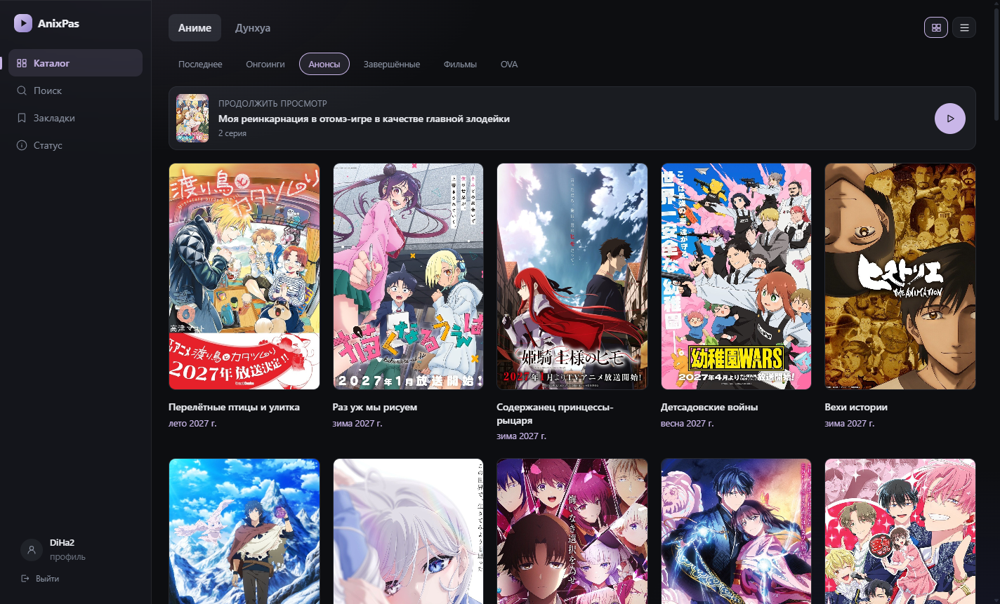

# AnixPas

Свой десктоп-клиент Anixart. Название — от японского 「パソコン」 (pasokon, «компьютер»).

Пишется с нуля для себя и под себя, не форк уже готовых решений. 



## Статус

**Версия 0.2.0 beta.** Работающее приложение: каталог, поиск, карточки, плеер,
история просмотра, закладки, торренты. Идёт доводка мелочей и добавление
автообновления.

## Скачать

Готовый установщик лежит в релизах:
**https://github.com/DinHem/anixpas-releases/releases/latest**

Требуется Windows 10/11 x64. Сертификата подписи кода нет — SmartScreen при
первой установке покажет «Неизвестный издатель», это ожидаемо.

## Обновления

Приложение само проверяет новые версии и подписывает их Ed25519. Канал
обновлений считается недоверенным: манифест проверяется вшитым публичным ключом,
потом сверяется `sha512` установщика. Подробности — `docs/03-security.md` §10.1.

## Стек

| Слой | Выбор |
|---|---|
| Оболочка | Electron 45 |
| UI | Svelte 5 (runes) |
| Сборка | rollup + electron-forge 8 |
| Плеер | hls.js (единый движок на все источники) |
| Язык | JavaScript (не TS) |

## Что умеет

**Каталог и поиск**
- сетка постеров с переключателем на список (выбор запоминается)
- подгрузка при прокрутке до низа
- поиск по названию, фильтры по жанрам (`genres` принимает названия строкой)

**Карточка тайтла**
- двухколоночная: постер, метрики, жанры, подробности / описание, кадры
- блок торрентов — только если у релиза есть источник Libria

**Плеер**
- hls.js, источники Kodik и Libria
- выбор качества (Libria — до 1080p, Kodik — 720p), позиция сохраняется при переключении
- скорость 0.5–2×, автопропуск опенинга/эндинга с отсчётом 5 с
- маркеры вставок на таймлайне, кнопка `+1:25` для Kodik
- полноэкранный режим, горячие клавиши, открытие во внешнем плеере (mpv/VLC)

**История просмотра**
- плашка «Продолжить просмотр» на каталоге
- галочки просмотренного, «Просмотрено до 15:14»
- диалог «Продолжить / Начать сначала»
- прогресс раздельный по озвучкам **и** источникам

**Торренты**
- `.torrent` файлом, нормальное имя, санитизация пути

## Источники данных

| API | Роль |
|---|---|
| **Anixart** (`api-s.anixsekai.com` и зеркала) | каталог, поиск, релизы, метаданные, озвучки, источники |
| **AniLibria** (`aniliberty.top/api/v1`) | прямые HLS-потоки, таймкоды опенинга, торренты |

Оба неофициальные/полуофициальные. Сетевой слой изолирован в `src/main/net/`, чтобы правка формата была в одном файле.

## Документация

Внутренние заметки (решения, прогресс, разведка API, скриншоты) ведутся в приватном
репозитории `DinHem/anixpas-notes` — в публичном коде их нет.

## Команды

```bash
npm start              # запуск в разработке
npm run build:renderer # только сборка рендерера
npm run smoke:api      # проверка сети и API (без окна)
npm run smoke:ui       # окно + проверки безопасности
npm run make           # собрать установщик
npx electron . --smoke=watch:1000   # сразу открыть экран серий релиза
```

## Где лежат данные

`%APPDATA%\AnixPas\`

| Файл | Что |
|---|---|
| `progress.json` | история просмотра |
| `settings.json` | скорость, автопропуск, вид каталога |
| `cache/` | кэш каталога и карточек (с TTL) |

## Лицензия

MIT — см. `LICENSE`. Проект некоммерческий, к Anixart и AniLibria отношения не имеет,
использует их публичные API.
